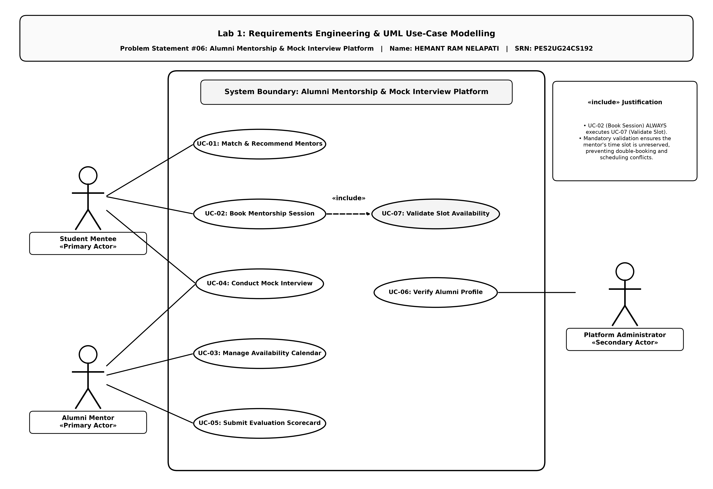

# Lab 1: Requirements Engineering & UML Use-Case Modelling

## Student & Assignment Metadata
- **Name:** HEMANT RAM NELAPATI
- **SRN:** PES2UG24CS192
- **Problem Statement:** #06 — *Alumni Mentorship & Mock Interview Platform*
- **Domain:** Campus & Academic Operations

---

## Unified 3-Page PDF Submission
A unified submission document is compiled as **[`PES2UG24CS192-Hemant-lab1.pdf`](file:///h:/Sem-5/SE/Lab-1/PES2UG24CS192-Hemant-lab1.pdf)**:
- **Page 1:** Requirements Specification Table (with single cover header: Name, SRN, Problem Statement #06)
- **Page 2:** UML Use-Case Diagram (with section heading `2. UML Use-Case Diagram`)
- **Page 3:** Use-Case Flow Specification (with section heading `3. Use-Case Flow Specification`)

---

## 1. Problem Context & Overview
Connecting students with alumni working in specialized industry domains requires:
1. **Intelligent Domain Matching:** Recommending verified alumni mentors to students based on domain specializations (e.g., Embedded Systems, Cloud Computing).
2. **Real-Time Calendar Availability:** Enabling mentors to publish open slots and students to book mock interview sessions while preventing double-booking and scheduling conflicts.
3. **Structured Post-Interview Scorecards:** Allowing alumni mentors to record and submit standardized evaluation rubrics (Technical Skills, Problem Solving, Communication) with qualitative remarks.

### Identified Stakeholders & Actors
- **Student Mentee (Primary Actor):** Explores recommended mentors by domain specialization, books mock interview slots, attends sessions, and views structured feedback scorecards.
- **Alumni Mentor (Primary Actor):** Publishes availability calendar slots, conducts mock interviews, and submits structured post-interview evaluation scorecards.
- **Platform Administrator (Secondary Actor):** Verifies alumni profiles and credentials to ensure platform authenticity and manages domain classification.

---

## 2. Requirements Specification Table

| Req ID | Type | Description | Priority | Acceptance Criteria | Rationale | Comments |
| :--- | :--- | :--- | :---: | :--- | :--- | :--- |
| **FR-001** | Functional | The system shall recommend verified alumni mentors to student mentees based on their selected domain specialization (e.g., Embedded Systems, Cloud Computing). | **High** | **Pass:** When a student selects a domain (e.g., "Cloud Computing"), the system displays verified alumni mentors associated with that domain, with mentors having the strongest domain match presented first.<br>**Fail:** Unverified or domain-unmatched mentors are recommended. | Core mentor discovery mechanism connecting students with relevant alumni expertise for targeted career preparation. | Domain tags are selected from pre-approved campus academic taxonomies. |
| **FR-002** | Functional | The system shall book a mock interview session for a student mentee from the mentor's published open calendar slots and prevent double-booking. | **High** | **Pass:** Selected time slot is confirmed, added to both student and mentor platform schedules, and locked from further booking.<br>**Fail:** Double-booking occurs on the same mentor slot. | Eliminates scheduling conflicts and provides dependable session booking. | Slot availability is validated in real-time before booking confirmation. |
| **FR-003** | Functional | The system shall allow alumni mentors to create, update, and publish their available dates and time slots for mentorship sessions. | **Medium** | **Pass:** Mentor-defined availability intervals immediately appear as selectable slots on the student booking interface.<br>**Fail:** Published slots do not reflect on student calendar or past dates are allowed. | Enables alumni mentors to manage their contribution time according to their professional schedule. | Mentors can mark specific slots as unavailable prior to reservation. |
| **FR-004** | Functional | The system shall allow the alumni mentor to record and submit a structured post-interview scorecard using standardized evaluation rubrics and feedback. | **High** | **Pass:** Scorecard containing ratings across standardized rubrics (Technical Skills, Problem Solving, Communication) is saved and made accessible to the mentee.<br>**Fail:** Submission allowed with mandatory evaluation rubrics omitted. | Delivers structured, actionable evaluation to help students improve interview performance. | Scorecard submission completes the mock interview session lifecycle. |
| **FR-005** | Functional | The system shall allow the platform administrator to review and verify alumni profiles and domain qualifications before mentor activation. | **Medium** | **Pass:** Alumni profile becomes visible in student mentor search only after administrator status is marked as 'Verified'.<br>**Fail:** Unverified alumni profile appears in search or booking. | Preserves platform credibility and ensures high-quality alumni guidance. | Admin verification status is logged and maintained on the mentor profile. |
| **NFR-001** | Nonfunctional | The system shall restrict access to a student's post-interview evaluation scorecard to the concerned student, the corresponding alumni mentor, and authorized platform administrators. | **High** | **Pass:** Only the concerned student mentee, associated alumni mentor, and authorized platform administrator can retrieve the scorecard.<br>**Fail:** Any unauthorized platform user can retrieve or view the scorecard. | Protects student performance data confidentiality and ensures privacy of academic feedback. | Enforced via platform role-based access control (RBAC). |
| **NFR-002** | Nonfunctional | The system shall return domain-matched mentor search results within 2.0 seconds under simulated peak campus placement load. | **Medium** | **Pass:** 95% of mentor search queries return complete matching results in $\le$ 2.0 seconds during peak concurrent student access.<br>**Fail:** Search response time exceeds 2.0 seconds. | Maintains responsive platform performance during high-traffic academic placement and mock interview periods. | Evaluated through standard performance benchmarking. |

---

## 3. UML Use-Case Diagram



### Actors
- **Student Mentee (Primary Actor)**
- **Alumni Mentor (Primary Actor)**
- **Platform Administrator (Secondary Actor)**

### Use Cases & Traceability
- **UC-01:** `Match & Recommend Mentors` *(Traces to FR-001)*
- **UC-02:** `Book Mentorship Session` *(Traces to FR-002)*
- **UC-03:** `Manage Availability Calendar` *(Traces to FR-003)*
- **UC-04:** `Conduct Mock Interview` *(Traces to Problem Context)*
- **UC-05:** `Submit Evaluation Scorecard` *(Traces to FR-004)*
- **UC-06:** `Verify Alumni Profile` *(Traces to FR-005)*
- **UC-07:** `Validate Slot Availability` *(Mandatory included verification step in UC-02)*

### Include Relationship Justification
- **`<<include>>` Relationship (`UC-02: Book Mentorship Session` $\rightarrow$ `UC-07: Validate Slot Availability`):**
  - *Rationale:* Whenever a mentorship session is booked (`UC-02`), the system unconditionally validates that the requested time slot is open and unreserved (`UC-07`). This mandatory validation directly satisfies the core requirement of eliminating scheduling conflicts and preventing double-booking.

---

## 4. Use-Case Flow Specification

### Use Case: UC-02: Book Mentorship Session
- **Primary Actor:** Student Mentee
- **Secondary Actor:** None *(Alumni Mentor published availability slots as a precondition; mentor does not directly participate in the booking transaction)*
- **Preconditions:**
  1. Student Mentee is logged into the platform.
  2. Alumni Mentor has published active availability slots.
- **Postconditions:**
  1. Mock interview session is confirmed and added to both platform schedules.
  2. Selected time slot is locked to prevent double-booking.

#### Main Success Scenario (MSS)
1. Student Mentee browses recommended mentors and opens a verified Alumni Mentor profile.
2. System retrieves and displays the mentor's profile details and published availability calendar.
3. Student Mentee selects an available date and time slot for a mock interview.
4. System executes **UC-07: Validate Slot Availability** (`<<include>>`) to verify the selected slot remains unreserved.
5. System creates the session reservation and locks the time slot to prevent double-booking.
6. System adds the confirmed session to both the Student Mentee's and Alumni Mentor's platform schedules.
7. System displays a booking confirmation message with complete session details to the Student Mentee.

#### Alternate Flow
- **4a. Selected Slot Unavailable / Concurrently Booked (Branch from Step 4)**
  - **4a1.** System detects that the selected time slot was locked by another student or is no longer open.
  - **4a2.** System displays an alert notification: *"The selected time slot is no longer available."*
  - **4a3.** System refreshes the mentor's availability calendar with remaining open slots.
  - **4a4.** Student Mentee selects an alternative open time slot (resumes at Step 3) or cancels booking.

---

## 5. Deliverable Directory Structure
```
Lab-1/
├── README.md                                  # Complete Lab 1 specification & documentation
├── PES2UG24CS192-Hemant-lab1.pdf              # Unified 3-Page PDF Deliverable (SRN-Name-lab1)
├── PES2UG24CS192-HEMANT_RAM_NELAPATI-lab1.pdf # Unified 3-Page PDF Deliverable (Full Name)
├── Requirements_Table.xlsx                    # Formatted Excel Requirements Table
├── Requirements_Table.docx                    # Word format Requirements Table (Landscape)
├── use_case_diagram.puml                      # PlantUML editable source diagram
├── use_case_diagram.png                       # High-resolution rendered UML diagram
├── use_case_diagram.pdf                       # Standalone PDF UML diagram
├── Use_Case_Flow.docx                         # Word format Use-Case Flow document
└── Use_Case_Flow.pdf                          # Standalone 1-page PDF Use-Case Flow
```
